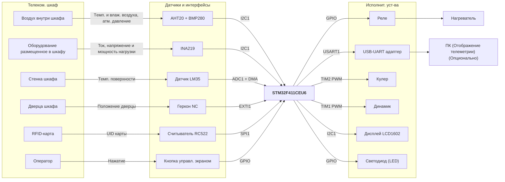

## Прототип автономного контроллера телекоммуникационного шкафа (v1.0)

### Основные возможности

- Мониторинг температуры и относительной влажности
- Измерение атмосферного давления
- Измерение напряжения, тока и мощности нагрузки
- Получение аналоговых данных через АЦП с использованием DMA.
- Расчёт точки росы и оценка риска конденсации
- Управление кулером
- Управление нагревателем через реле
- Обнаружение открытия двери
- RFID-идентификация пользователей
- Отображение параметров и состояния системы на экране
- Звуковая сигнализация при возникновении нештатных ситуаций.

### Особенности прототипа:
В текущей версии прототипа температура поверхности на стенке шкафа имитируется потенциометром (вместо датчика температуры LM35). Это сделано, чтобы иметь возможность тестировать установку в комнатных условиях.

 

### Структурная схема устройства

Компонент	                  |  Назначение                                     |    Технологии    
|---|---|---|
AHT20	                      |  Измерение температуры и влажности                | **I2C**
BMP280	                     | Измерение атмосферного давления                  | **I2C**
INA219	                    |  Измерение напряжения, тока и мощности нагрузки    | **I2C**	
EM-409                      |   Согласование логических уровней (3,3В -> 5В)        |**I2C** 
LCD1602 + PCF8574	        |    Отображение телеметрии и состояния системы          | **I2C**	
RC522	                     |   RFID-идентификация оператора                            | **SPI**
Диагностический выход       |   Отладочный вывод телеметрии                           |  **UART**
Кулер                  	   |  Охлаждение оборудования                                    |  **TIM / PWM**
Динамик	                   |   Звуковая сигнализация при нештатных ситуациях           | **TIM / PWM**
Геркон	                   |   Контроль состояния двери                                | **GPIO EXTI**
Кнопка	                   |   Переключение 4 информационных экранов                      | **GPIO Input**
Реле	                     |   Включение нагревателя при приближении к точке росы        | **GPIO Output**
Потенциометр №1           | Имитация датчика температуры(LM35) на стенке шкафа           | **ADC + DMA**
Потенциометр №2	          |  Регулировка температуры срабатывания кулера               | **ADC + DMA**

 

## Мониторинг и контроль конденсации

Для оценки риска образования конденсата используется расчёт точки росы по формуле Магнуса.

$\gamma = \ln(RH/100) +
\frac{17.62T}{243.12+T}$

$T_{dew} =
\frac{243.12\gamma}{17.62-\gamma}$

где:
- $T$ — температура воздуха;
- $RH$ — относительная влажность;
- $T_{dew}$ — расчётная температура точки росы.

На основании разницы между температурой поверхности и точкой росы ($\Delta T = T_{surface} - T_{dew}$) определяется состояние риска конденсации и формируется запрос на включение нагревателя.

 

## Управление кулером и нагревателем (климат-контроль)
### Вентиляция
Если температура воздуха внутри шкафа превышает установленный порог, то происходит пропорциональный разгон кулера.

### Нагрев
Если температура воздуха внутри шкафа опустилась ниже установленного порога или возник риск конденсации (т.е. температура на стенке шкафа приблизилась к точке росы), то подается сигнал на реле нагревателя.

 

## Контроль доступа

На внутренней стороне дверцы установлен геркон в нормально закрытом состоянии. При открытии дверцы контакт на герконе размыкается и система переходит в режим ожидания RFID-идентификации (15 секунд). UID считанной карты проверяется по списку разрешённых идентификаторов. При неизвестной карте или истечении времени ожидания формируется сигнал тревоги.

 

## Интерфейс оператора

Оператор переключает **4 штатных экрана** по кругу нажатием кнопки. При возникновении критической аварии система автоматически перекрывает текущий экран приоритетным предупреждением.

| Режим / Экран | Пример вывода (16×2) | Что отображается |
|---|---|---|
| **1. Микроклимат** *(штатный)* | `1.Air T: 24.5 C` `  Humid: 48.2 %` | Температура и относительная влажность воздуха внутри шкафа. |
| **2. Давление и роса** *(штатный)* | `2.P:752mm,D:12.8C` `S:21.0C dT:8.2C` | Атмосферное давление, расчётная точка росы, температура стенки шкафа и запас до конденсации|
| **3. Питание нагрузки** *(штатный)* | `3.U:5.02V,I:145mA` `  Power: 728 mW` | Напряжение шины, ток потребления и мощность оборудования шкафа |
| **4. Статус системы** *(штатный)* | `4.Fan:45%,Ht:OFF` `Dr:CLS,Set:28C` | Скорость кулера (%), статус реле нагрева, состояние дверцы (`CLS`/`OPN`/`AUT`), порог температуры для включения кулера  |
| **Авария доступа** *(приоритетный)* | `!ACCESS ALARM!` `AUTH TIMEOUT!` | Срабатывает при открытии дверцы без предъявления разрешённой RFID-карты за 15 секунд (если поднесен чужой ключ, то выводится `UNKNOWN RFID TAG`). |
| **Риск конденсата** *(приоритетный)* | `!DEW CRITICAL!` `dT:1.4C HEAT:ON` | Включается, если температурный запас до точки росы ниже `2.0 °C`. Далее автоматически запускается обогрев шкафа. |
| **Отказ датчика** *(индикация)* | `1.Air T: ERR` `  Humid: ERR` | При обнаружении ошибки у соответствующего устройства вместо его показаний отображается сообщение об ошибке |

 

## Сигнализация

Звуковое оповещение срабатывает в 3 случаях:
1. После открытия дверцы не была произведена идентификация или карта не входила в список разрешенных;
2. Критическая близость к точке росы;
3. Неисправен один из датчиков.

Для каждого случая предусмотрен свой звуковой шаблон.

 

## Схема подключения

## Инструменты разработки
- C,
- VS Code,
- STM32F411CEU6,
- STM32CubeMX STM32 HAL,
- CMake,
- Ninja,
- ARM GNU Toolchain (arm-none-eabi-gcc),
- OpenOCD,
- ST-Link v2

## Ограничения прототипа
- сборка выполнена на макетной плате без корпуса шкафа;
- датчик температуры поверхности(LM35) имитируется потенциометром, чтобы иметь возможность тестирования установки в комнатных условиях;
- авторизация RFID выполняется по `UID` без криптографии.

## Планы развития (v2.0)
- контроль оборотов кулера;
- энергонезависимый журнал событий во внешней Flash/EEPROM;
- отправка телеметрии по GSM/Ethernet и удалённый мониторинг;
- изготовление корпуса;
- промышленная система питания;
- аккумуляторы и автономное резервное питание;
- авторизация с использованием криптографии.

## Документация к используемым компонентам

- [STM32F411CE](https://shop.robotclass.ru/image/data/datasheets/STM32F411.pdf) — микроконтроллер STM32F411
- [AHT20](https://files.seeedstudio.com/wiki/Grove-AHT20_I2C_Industrial_Grade_Temperature_and_Humidity_Sensor/AHT20-datasheet-2020-4-16.pdf) — датчик температуры и влажности.
- [BMP280](https://amperkot.ru/static/3236/uploads/datasheets/BST-BMP280.pdf?srsltid=AYCX9vIM2xWhvIDWypaOtfZoKA-U1uDxpKWia6uoGC_fn6m60KLXzgNA) — датчик давления.
- [INA219](https://cdn-shop.adafruit.com/datasheets/ina219.pdf) — датчик тока и напряжения.
- [PCF8574](https://www.danomsk.ru/upload/iblock/bff/41882_092a32325e1526cad44961fbe54e3e58.pdf) —  преобразователь интерфейса LCD на I2C для дисплея 1602.
- [HD44780](https://cdn.sparkfun.com/assets/9/5/f/7/b/HD44780.pdf) — контроллер символьного жидкокристаллического дисплея LCD 1602.
- [MFRC522](https://www.nxp.com/docs/en/data-sheet/MFRC522.pdf) — RFID-RC522 считыватель.
